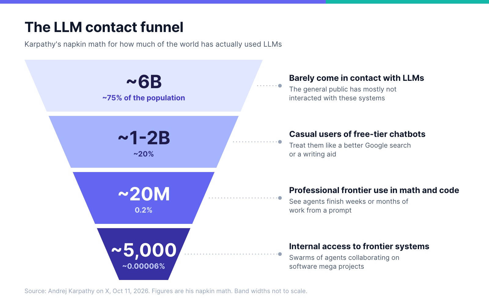
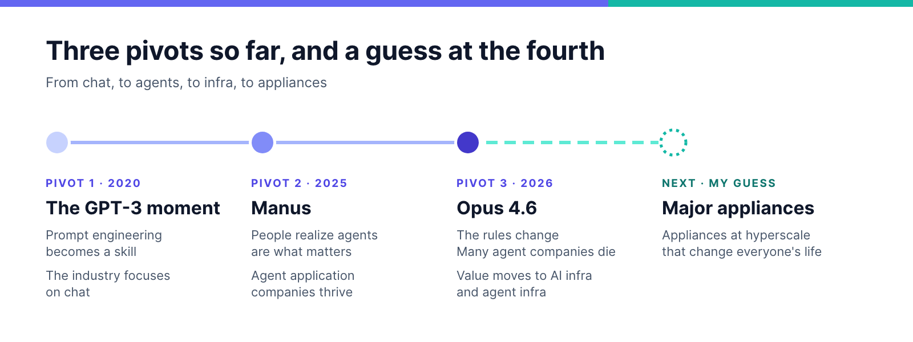
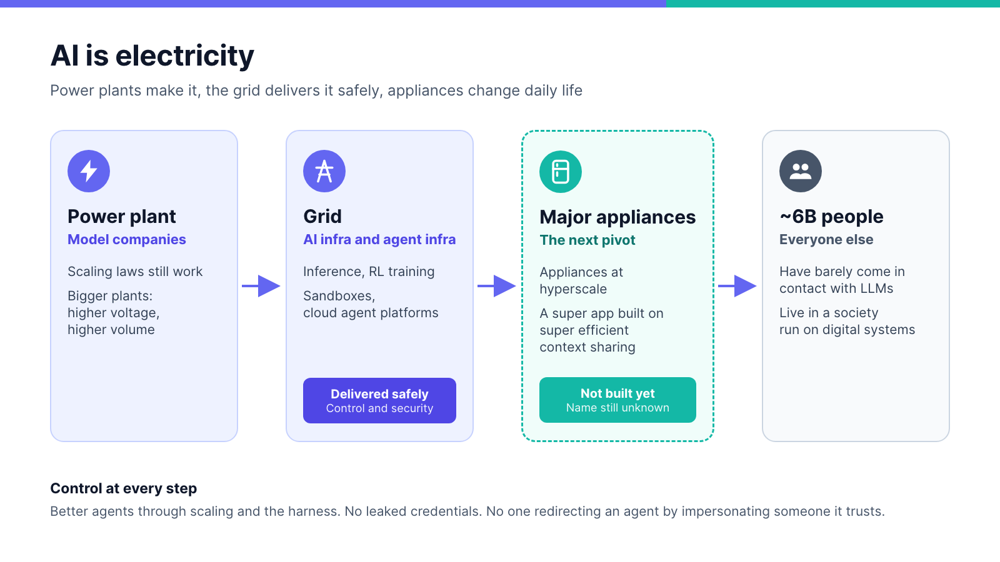

Something surprised me recently. People I never expected to touch AI, including elderly people, came to me asking how to find an image they had seen online. It turned out the image was AI-generated. They didn't go looking for AI. AI found them.

I keep coming back to that when I think about where the AI industry is going. The models will keep getting stronger. Whether that changes anyone's life comes down to two things: control and delivery. And delivery is still missing its most important piece, which I'll call the major appliance.

## Control

Control means two things to me: getting an agent to do what you want, and making sure nobody else can make it do what they want.

The first is about making agents better. There are two levers for that: the model itself, which keeps improving along the scaling laws (more compute and data keep producing more capable models), and the harness around it, meaning the tools, context, and environment the model works inside. Both matter, and the harness is often where the practical gains show up first.

The second is security. An agent that can do real work is an agent that holds real access. It has to keep credentials from leaking. It also has to keep its integrity: it should not be altered or redirected by someone impersonating a person it trusts. As agents take on more of our work, the question stops being "can it do the task?" and becomes "can I trust that it is still working for me?"

## Delivery

Andrej Karpathy recently did some [napkin math](https://x.com/karpathy/status/2109361546505966046) (Oct 11, 2026): somewhere around 6 billion people, about 75% of the world, have barely come in contact with LLMs at all. To me that is the delivery problem in one number. Most people have not yet had the chance to use these tools to improve their own lives.

He lays it out as a funnel. Below those 6 billion are 1 to 2 billion casual users of free chatbots, about 20 million people who use frontier models professionally, and roughly 5,000 with internal access to frontier systems.

I'm not saying everyone has to love AI. But I do believe AI can and will replace digital work broadly, and that will heavily affect everyone living in a society that runs on digital systems. Like the people who asked me about that image, they will feel it whether they opt in or not. So the job is to make sure they also get the benefit.

## Three pivots so far

Looking back, I see three turning points.

**1. The GPT-3 moment (2020).** Prompt engineering became a skill, and once ChatGPT arrived in 2022 the industry focused on chat.

**2. Manus (2025).** People realized agents were the thing that mattered, and a lot of agent application companies thrived.

**3. Opus 4.6 (2026).** It changed the rules. The first time I used it, I was amazed by how flexible it was. The model was moving faster than the harness: a better model could handle most things on its own, so much of what agent companies had built stopped mattering. Many of them died. Relay.app, an agent workflow tool, shut down after larger platforms built the same automation in, and Ollie, an AI family assistant, closed after failing to stand out (both are on [TechCrunch's running list of AI shutdowns](https://techcrunch.com/2026/11/14/the-ai-graveyard-a-running-list-of-projects-and-startups-that-didnt-make-it/)). Value moved down the stack, to the infrastructure that supports agents. AI infra, like inference and RL training, is thriving. So is agent infra, like sandboxes and cloud agent platforms.

## What comes next: AI as electricity

The best analogy I have is electricity.

Model companies are the power plants. Scaling laws still work, so they keep building bigger plants: higher voltage, higher volume.

But power on its own doesn't light a single home. You need a grid to deliver it safely. That is the role of infra companies: getting this power to everyone, reliably, without anyone getting hurt. Control and delivery, again.

Then there is the part that actually changes daily life. Nobody's life changed because a power plant existed. It changed because of the major appliances that plugged into the grid: the TV, the fridge, the air conditioner.

My guess is that the next pivot is appliances at hyperscale: products that draw power from the grid and change everyone's life, not just the lives of developers and early adopters.

Chatbots are the closest thing we have today, and 1 to 2 billion people already use them. But ChatGPT is still a tool for personal chat and search. It helps one person at a time. It has not yet strengthened the connections between people.

Put together, the whole chain looks like this:

## The super app I'm waiting for

I believe one of those appliances will be a super app that changes the media system. Media has changed before: from newspapers to radio to television. Each step changed how context is shared, from paper to audio to vision. The next step is agents.

I don't think it exists yet. It isn't Meta's Muse and it isn't xAI's Grok Bot. Amazon has [blocked Muse](https://www.geekwire.com/2026/amazon-blocks-metas-muse-ai-assistant-in-new-standoff-over-agentic-shopping/) from shopping on its site, [Grok Bot users report the same](https://cybernews.com/tech/musk-amazon-rival-amid-grok-bot-block/), and other companies are tightening their rules on agents too. It isn't any other app I've used so far either. I don't know its name. But I'm fairly sure about its core feature: super efficient context sharing. Moving what one person, or one agent, knows to another person or agent with almost no friction.

Today, so much effort goes into re-explaining. Copying, pasting, summarizing, catching people up. This isn't only an office problem. The people who came to me about that image had to find someone they trusted and explain what they had seen. That is context sharing at its most manual.

Whoever makes context flow as easily as electricity flows through a wire will build the appliance everyone ends up using, including those 6 billion people who haven't really started yet.

That's my bet. The power plants will keep getting bigger. The interesting work is in the grid and the appliances, and in making sure all of it stays under control.
