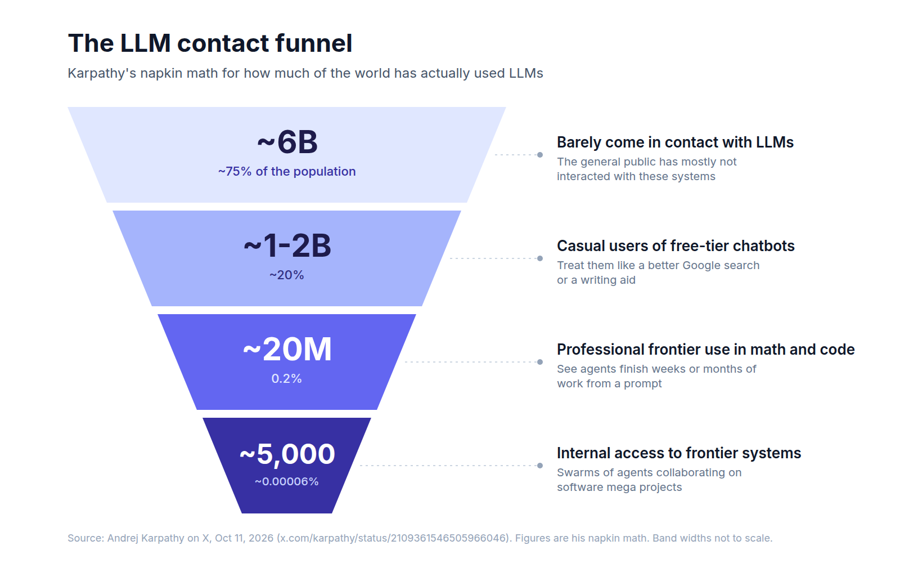
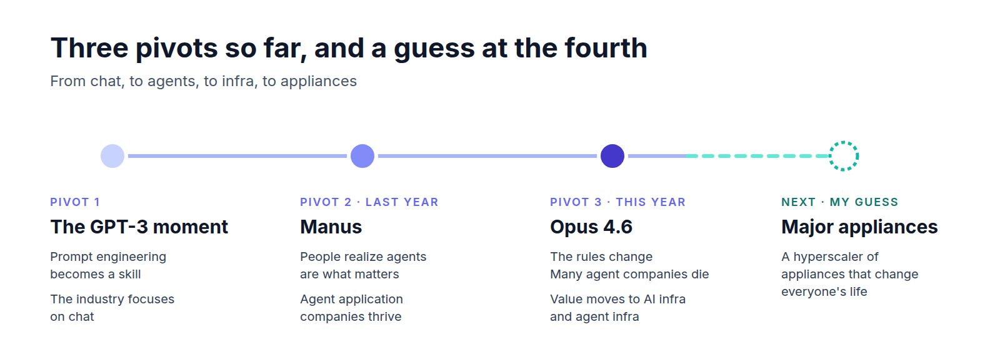
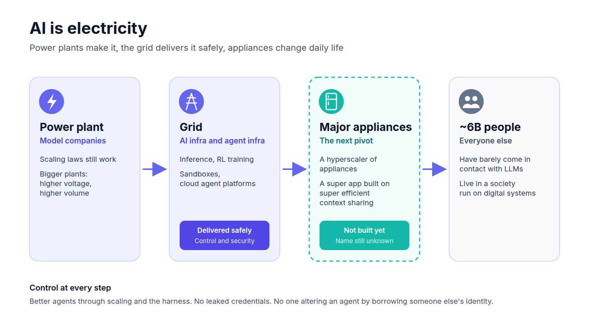

*模型会越来越强，但它能否改变普通人的生活，取决于两件事：控制与交付。*

最近我一直在思考 AI 行业的走向，每次得出的答案都一样：最重要的两件事是控制（Control）与交付（Delivery）。

## 控制

对我来说，控制包含两层含义。

第一层是让 Agent 变得更好。这里有两个杠杆：一是模型本身，它沿着 Scaling Law 持续进步；二是模型外面的 Harness，也就是模型所依赖的工具、上下文和运行环境。两者都很重要，而实际收益往往最先出现在 Harness 上。

第二层是安全。一个能做真正工作的 Agent，必然握有真正的权限。它必须防止凭证泄露，也必须保持自身的完整性：不能被那些冒用他人身份骗取信任的未授权者篡改或劫持。随着 Agent 承担越来越多的工作，问题将不再是“它能不能完成任务？”，而是“我能否相信它仍在为我工作？”

## 交付

Andrej Karpathy 最近做了一个粗略估算：全球大约有 60 亿人，约占 75%，几乎从未接触过 LLM。在我看来，这一个数字就概括了交付问题：大多数人还没有机会用这些工具改善自己的生活。

他把这件事画成了一个漏斗：

*图 1. LLM 接触漏斗。数据来自 Karpathy 在 [X 上的帖子](https://x.com/karpathy/status/2109361546505966046)（2026 年 10 月 11 日）中的粗略估算，各层宽度并非按比例绘制。*

有件事让我很意外：一些我从没想过会接触 AI 的人，包括老年人，来问我怎么找到他们在网上看到的一张图片。结果那张图片是 AI 生成的。他们并没有主动去找 AI，而是 AI 找到了他们。

我并不是说每个人都必须喜欢 AI。但我确实相信，AI 能够而且将会广泛取代数字化工作，这会深刻影响每一个生活在数字化社会中的人。无论人们是否选择参与，都会感受到它的影响。所以我们要做的，是确保他们也能从中受益。

## 迄今为止的三次转折

回头看，我认为有三个转折点。

**1. GPT-3 时刻。** Prompt Engineering 成为一项技能，整个行业聚焦于聊天。

**2. Manus。** 人们意识到 Agent 才是真正重要的东西。去年，大量 Agent 应用公司蓬勃发展。

**3. Opus 4.6。** 今年它改变了规则。第一次使用时，我就被它的灵活性震撼了。许多 Agent 公司倒下，价值沿着技术栈下沉到支撑 Agent 的基础设施：推理、RL 训练等 AI Infra 正在繁荣，沙箱、云端 Agent 平台等 Agent Infra 也是如此。

*图 2. 迄今为止的三次转折，以及我对第四次的猜测。*

## 下一步：AI 如电力

我能想到的最好类比是电力。

模型公司就是发电厂。Scaling Law 依然有效，所以它们不断建造更大的电厂：更高的电压，更大的发电量。

但电力本身点不亮任何一个家庭。你需要电网把它安全地输送出去。这正是 Infra 公司的角色：可靠地把电力送到每个人手中，同时不伤害任何人。又是控制与交付。

然后才是真正改变日常生活的部分。没有人的生活因为一座发电厂的存在而改变，改变生活的是接入电网的大家电：电视、冰箱、空调。

我的猜测是，下一次转折将是大家电级别的超大规模产品：从电网取电，改变每个人的生活，而不仅仅是开发者和早期用户的生活。

把这些串起来，整条链路是这样的：

*图 3. AI 如电力。模型公司发电，Infra 安全输电，大家电把电力带进每个人的日常生活。*

## 我在等待的超级应用

我相信，其中一件大家电会是一个改变媒体体系的超级应用。

我认为它还不存在。它不是 Muse，不是 Grok bot，也不是我用过的任何应用。我不知道它叫什么名字，但我相当确定它的核心功能：超高效的上下文共享，几乎无摩擦地把一个人或一个 Agent 所知道的东西传递给另一个人或 Agent。

今天，大量精力被花在反复解释上：复制、粘贴、总结、给别人补背景。谁能让上下文像电流在导线中一样顺畅流动，谁就能造出人人都会用的那件大家电，包括那 60 亿还没真正开始使用 AI 的人。

这就是我的押注。发电厂会越建越大，而真正有意思的工作在电网和大家电上，以及确保这一切始终处于控制之中。
